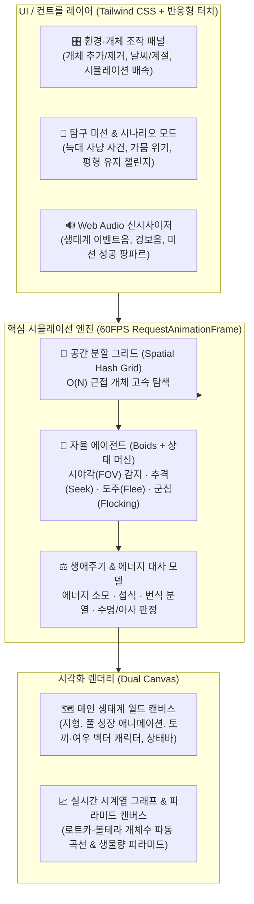

# 🌿 나만의 작은 생태계 균형 시뮬레이터 — 웹앱 구현 계획서

> [!NOTE]
> **프로젝트 개요**: 외부 AI API 없이 순수 클라이언트 사이드(HTML5 Canvas, 자율 에이전트 물리·행동 엔진, 실시간 데이터 시각화, Web Audio API 절차적 사운드 합성) 코딩 역량을 극대화하여 제작하는 **초등학교 5~6학년 과학 '생물과 환경(생태계 평형)' 단원 맞춤형 인터랙티브 교육용 웹앱**입니다.

---

## 1. 교육적 목표 및 핵심 학습 가치

* **대상 학년 및 과목**: 초등학교 5~6학년 과학 (2022 개정 교육과정 '생물과 환경' 단원 연계)
* **핵심 성취기준**: 생태계를 구성하는 생물 요소(생산자, 1차 소비자, 2차 소비자) 간의 먹고 먹히는 관계와 비생물적 환경 요인이 생태계 평형에 미치는 영향을 탐구한다.
* **학습자 경험 가치**:
  1. 교과서 속 정적인 '생태계 피라미드' 그림 대신, 화면 속에서 살아 움직이는 수백 개체의 **자율 행동(먹이 탐색, 추격, 도주, 번식)**을 직접 관찰합니다.
  2. 학생이 직접 특정 생물의 개체 수를 급격히 늘리거나 환경 재해(가뭄, 산불, 외래종 유입 등)를 발생시켜 보고, **시간의 흐름에 따라 생태계가 스스로 균형을 회복하거나 붕괴하는 과정**을 실시간 그래프로 확인합니다.

---

## 2. 시스템 아키텍처 및 기술 스택 (Zero-Setup 단일 파일 구조)

교실 전자칠판 및 학생용 스마트패드(태블릿/크롬북)에서 별도의 서버 설치나 빌드 과정 없이 더블 클릭만으로 즉시 구동되도록 **단일 `.html` 파일(Single-File Architecture)**로 설계합니다.

* **프론트엔드 UI**: HTML5 + Tailwind CSS (CDN) + Pretendard 웹폰트
* **그래픽스 및 차트**: 순수 HTML5 `Canvas 2D API` (외부 차트 라이브러리 없이 고성능 커스텀 시계열 그래프 및 생태계 피라미드 직접 렌더링)
* **사운드 효과**: `Web Audio API` 내장 주파수 합성 (MP3 파일 의존성 제로)

---

## 3. 핵심 알고리즘 및 기술 상세 설계

### 3.1. 자율 에이전트 행동 알고리즘 (Boids + FSM 결합)
각 생물 개체(에이전트)는 단순한 랜덤 이동이 아니라 **조향력(Steering Force) 기반 물리 벡터($\vec{p}, \vec{v}, \vec{a}$)**와 **유한 상태 머신(FSM)**을 가집니다.

| 계층 | 생물종 | 핵심 상태 및 행동 규칙 (Behavior Rules) | 주요 파라미터 |
| :--- | :--- | :--- | :--- |
| **생산자** | 🌱 **토끼풀 (Grass)** | • 햇빛과 강수량에 비례하여 일정 주기로 자연 발아 및 주변 번식 • 성장도($0\% \to 100\%$)에 따라 크기와 영양가(에너지 제공량) 증가 | 광합성 성장률, 최대 수용 밀도($K$) |
| **1차 소비자** | 🐇 **초원토끼 (Rabbit)** | • **평상시(Wander & Flock)**: 무리 지어 이동(결속·정렬·분리) • **먹이 탐색(Seek)**: 시야 반경($R_{\text{vision}}$) 내 가장 가까운 풀을 향해 가속 • **회피(Flee)**: 시야 내 여우 감지 시 반대 방향 최대 속력으로 도주 및 민첩한 방향 전환 | 이동 속도, 시야 반경, 기초 대사량, 번식 임계 에너지 |
| **2차 소비자** | 🦊 **붉은여우 (Fox)** | • **추격(Pursuit)**: 시야 반경 내 토끼의 이동 방향을 예측하여 추격 벡터 계산 • **영역 유지(Separation)**: 다른 여우와 일정 거리를 두어 사냥터 중복 방지 • **휴식(Rest)**: 포만감이 높을 때 이동 속도를 줄여 에너지 소모 최소화 | 최고 추격 속도, 사냥 시야각, 높은 대사 소모율 |

### 3.2. 수치 모델링: 초등 맞춤형 로트카-볼테라(Lotka-Volterra) 동역학
생태계가 너무 쉽게 전멸하지 않고 교육적인 **'진동하며 수렴하는 평형(Damped Oscillation)'**을 보여주도록 안전장치와 에너지 대사 수식을 설계합니다.

1. **개체별 에너지 방정식**:
   $$E_{t+1} = E_t - \left( E_{\text{basal}} + c \cdot \|\vec{v}\|^2 \right) \Delta t + E_{\text{gain}}$$
   * 이동 속력($\|\vec{v}\|$)이 빠를수록 에너지를 더 많이 소모하며, $E \le 0$이 되면 자연 도태됩니다.
   * $E \ge E_{\text{reproduce}}$ 도달 시 에너지를 절반씩 나누며 새로운 개체가 탄생합니다(하트 파티클 연출).
2. **초등 교육용 밸런스 보정(안정화 장치)**:
   * **풀의 휴면 뿌리 시스템**: 토끼가 풀을 모두 먹어 치워도 일정 시간 후 땅속 씨앗에서 최소한의 풀이 다시 자라나도록 설계하여 실험 초반의 허무한 전체 멸종을 방지합니다(단, '극심한 가뭄' 조작 시에는 멸종 가능).

### 3.3. 고속 충돌 및 시야 탐색 최적화 (Spatial Hash Grid)
* 최대 500개 이상의 개체(풀 300개, 토끼 150마리, 여우 50마리)가 매 프레임 서로의 거리를 비교할 때 발생하는 $O(N^2)$ 연산 병목을 해결하기 위해, 월드를 격자 셀(예: $60 \times 60\text{px}$)로 나누는 **Spatial Hash Grid**를 구현하여 인접한 9개 셀만 탐색($O(N)$)합니다.

---

## 4. 화면 레이아웃 및 인터랙티브 기능 명세

대형 전자칠판(16:9 가로형)과 태블릿 화면 모두에서 한눈에 들어오도록 **좌측 시뮬레이션 월드(65%) + 우측 데이터 대시보드 및 컨트롤러(35%)** 구조로 배치합니다.

### 4.1. 메인 생태계 월드 캔버스 (좌측 영역)
* **시각적 표현**:
  * 귀여운 2D 벡터 캐릭터 렌더링 (이동 방향을 바라보는 귀와 꼬리 애니메이션, 배고픔 상태일 때 머리 위 말풍선 아이콘 표시).
  * **시야 반경 토글**: 특정 토끼나 여우를 클릭(터치)하면 해당 개체의 **시야 반경 원(FOV)**과 **현재 목표물(화살표 벡터)**, **남은 에너지 게이지**를 돋보기처럼 추적 관찰할 수 있는 '개체 팔로우 카메라' 기능.
* **직접 터치 브러시 도구**:
  * `[🌱 풀 심기]`, `[🐇 토끼 놓아주기]`, `[🦊 여우 놓아주기]`, `[🧹 개체 지우개]` 버튼을 선택한 뒤 월드 캔버스를 드래그하거나 터치하면 해당 위치에 즉시 생물이 생성/제거됩니다.

### 4.2. 실시간 데이터 분석 대시보드 (우측 상단)
* **탭 1 — 실시간 개체 수 변화 꺾은선 그래프 (Time-Series Line Chart)**:
  * 초록색(풀), 파란색(토끼), 주황색(여우) 세 개의 곡선이 실시간으로 흐르며 그려집니다.
  * "토끼 증가 $\to$ 풀 감소 및 여우 증가 $\to$ 토끼 감소 $\to$ 여우 감소 및 풀 회복"의 **위상차(Phase lag) 파동**을 직관적으로 관찰할 수 있습니다.
  * 환경 사건(예: "⚡ 가뭄 발생", "🦊 여우 대량 제거")이 일어난 시점에 그래프 상단 세로 점선 마커(이벤트 로그)가 자동으로 찍힙니다.
* **탭 2 — 실시간 생태계 피라미드 (Trophic Pyramid)**:
  * 현재 살아있는 생산자·1차 소비자·2차 소비자의 개체 수 비율을 3단 블록 피라미드로 시각화합니다.
  * 평형이 깨져 역피라미드나 기형적 구조가 되면 피라미드 블록이 흔들리며 **"⚠️ 생태계 불균형 경고!"** 배지가 점멸합니다.

### 4.3. 환경 변수 조작 및 시나리오 미션 (우측 하단)
* **환경 조절 슬라이더**:
  * ☀️ **일조량 및 강수량** (풀의 번식 속도 제어: `사막화` $\leftrightarrow$ `비옥한 초원`)
  * 🏃 **생물 이동 및 시뮬레이션 배속** (`0.5x 느리게 관찰` / `1x 기본` / `2x 빠르게` / `4x 고속 실험`)
* **교과서 연계 3대 탐구 미션 모드 (게이미피케이션)**:
  1. **미션 1 [기초 탐구] "평화로운 초원 만들기"**: 60초 동안 세 생물종이 모두 멸종하지 않고 안정적인 피라미드 비율을 유지하도록 초기 개체 수 배치하기.
  2. **미션 2 [역사적 사례] "카이바브 고원의 비극 체험하기"**: 토끼가 불쌍하다고 여우를 모두 없애면 어떻게 될까? 여우를 0마리로 제거한 뒤 토끼의 폭발적 증가와 초원 황폐화, 그리고 토끼의 대량 아사 과정을 직접 목격하고 보고서 퀴즈 풀기.
  3. **미션 3 [위기 극복] "갑작스러운 가뭄에서 생태계 구하기"**: 가뭄으로 풀이 급감한 위기 상황에서 적절한 개입으로 생태계 붕괴 막아내기.

---

## 5. 모듈별 코드 구조 설계 (`ecosystem_simulator.html`)

단일 파일 내부를 명확한 모듈 주석 섹션으로 구조화하여 유지보수성과 가독성을 확보합니다.

| 섹션 순서 | 모듈명 | 핵심 클래스 / 함수 | 주요 역할 |
| :---: | :--- | :--- | :--- |
| **1** | **Design & Layout** | Tailwind Config, DOM Layout | 전자칠판/태블릿 대응 반응형 레이아웃, 미션 모달, 컨트롤 패널 UI |
| **2** | **Sound Synthesizer** | `class SoundFX` | Web Audio API 기반 풀 생성음, 포식 효과음, 경고음, 미션 클리어 팡파르 |
| **3** | **Math & Spatial Grid** | `class Vec2`, `class SpatialGrid` | 2D 벡터 연산 및 $O(N)$ 근접 개체 탐색 해시 그리드 |
| **4** | **Autonomous Agents** | `class Grass`, `class Animal` (`Rabbit`, `Fox`) | Boids 조향 물리(Seek, Flee, Wander, Separation), 에너지 대사, 번식 로직 |
| **5** | **Simulation World** | `class EcosystemWorld` | 전체 개체 풀 관리, 날씨/계절 이벤트 적용, 시계열 통계 데이터 샘플링 |
| **6** | **Custom Visualizers** | `class WorldRenderer`, `class ChartRenderer` | 메인 캔버스 캐릭터/이펙트 드로잉, 시계열 꺾은선 그래프 & 피라미드 렌더링 |
| **7** | **Mission & Quiz Controller** | `class MissionManager` | 3단계 탐구 미션 달성 판정, 형성평가 OX/객관식 퀴즈 팝업, 축하 폭죽(Confetti) |

---

## 6. 단계별 개발 및 검증 로드맵

1. **Phase 1 — 코어 엔진 및 Boids 자율 행동 구현**:
   * `Vec2` 물리 엔진과 `SpatialGrid`를 작성하고, 풀·토끼·여우가 자연스럽게 시야 내 먹이를 쫓고 천적을 피해 달아나는 조향 알고리즘을 구현합니다.
2. **Phase 2 — 생태계 파라미터 밸런싱**:
   * 아무런 조작을 하지 않은 기본 상태에서 최소 3분 이상 세 종이 멸종하지 않고 주기적인 파동을 그리며 공존하도록 초기 개체 수, 번식 쿨타임, 에너지 소모율을 정밀 튜닝합니다.
3. **Phase 3 — 실시간 데이터 시각화(그래프 & 피라미드) 연동**:
   * 0.5초마다 개체 수를 샘플링하여 스크롤되는 시계열 꺾은선 그래프와 이벤트 마커, 생태계 피라미드 애니메이션을 연결합니다.
4. **Phase 4 — 교육용 미션 시나리오, 사운드 및 학습 성찰 퀴즈 완성**:
   * 3가지 탐구 미션과 카이바브 고원 사례 기반 확인 퀴즈, Web Audio 효과음, 미션 성공 축하 폭죽(`launchConfetti`)을 결합하여 수업 현장에서 즉시 활용 가능한 완성본을 구축합니다.
